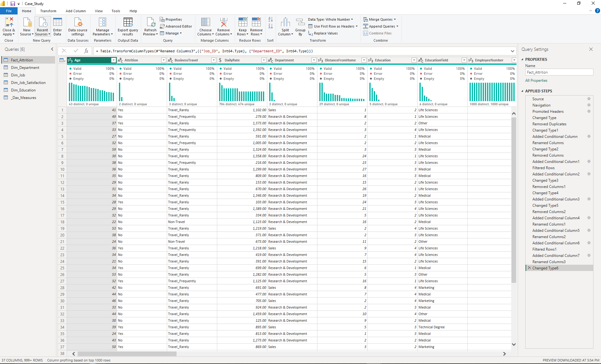
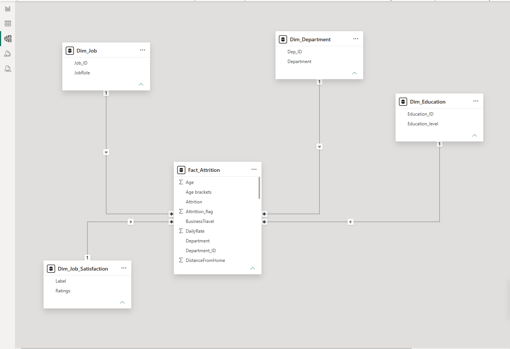
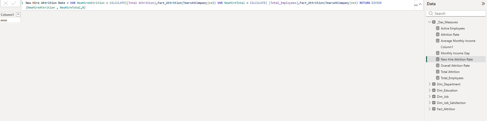
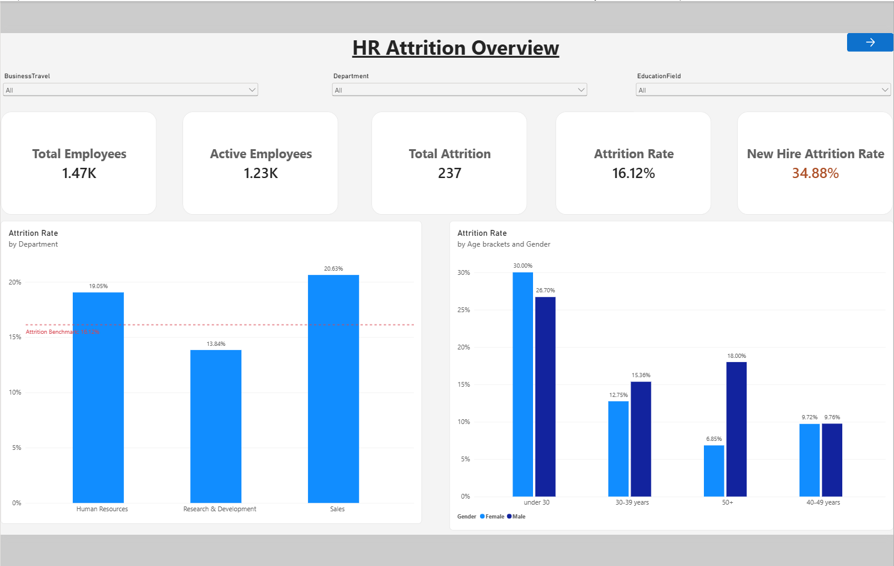
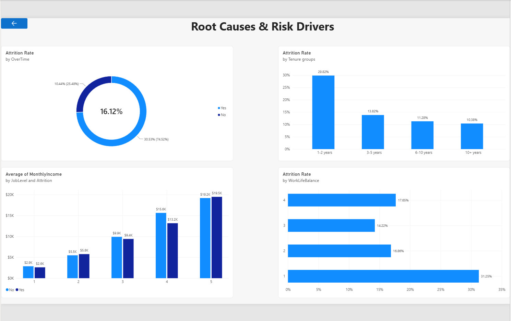

# HR Employee Attrition Analysis – Power BI

## Project Overview

This project focuses on analyzing employee attrition using Power BI. The goal was to explore employee data, identify patterns associated with attrition, and provide data-driven insights that can support employee retention decisions.

The project covers the full analysis process, including data cleaning and transformation, data modeling, DAX measures, interactive dashboard development, and business recommendations.

## Tools & Technologies

- Power BI
- Power Query
- DAX
- Excel

## Data Preparation & Cleaning

The original dataset was provided as a single employee-level table. I prepared the data using Power Query before building the analytical model.

Key steps included:

- Removed columns with constant values that did not provide analytical value.
- Reviewed and standardized data types.
- Checked the dataset for missing values and duplicate records.
- Prepared the cleaned employee data for the Power BI data model.



## Data Modeling

A Star Schema was created in Power BI to organize the employee attrition data and support efficient analysis.

The model consists of a central fact table connected to multiple dimension tables, allowing employee attrition to be analyzed across different business attributes.

### Model Structure

- Fact_Attrition – central employee attrition data and analytical measures.
- Dimension tables – used to organize attributes such as department, job, education, and job satisfaction.
- Relationships were created between the fact and dimension tables to support filtering and analysis across the dashboard.



## DAX Measures

DAX measures were created to calculate key HR metrics and support business analysis.

The measures include:

- Total Employees
- Attrition Count
- Active Employees
- Attrition Rate
- Average Monthly Income
- Average Tenure for Employees with Attrition




## Power BI Dashboard

The dashboard was designed to provide a concise overview of employee attrition and allow users to explore the main patterns through interactive visuals and filters.

### Overview

The Overview page presents the main HR metrics and provides a high-level view of employee attrition across the organization.



### Root Causes & Attrition Factors

The Root Causes page explores factors associated with employee attrition, including overtime, work-life balance, tenure, department, and other employee characteristics.



## Key Insights

The analysis identified several patterns associated with employee attrition:

- The overall attrition rate is 16.12%.
- Sales has the highest attrition rate among the departments at 20.63%.
- Employees working overtime have a higher attrition rate compared with employees who do not work overtime.
- Employees with lower work-life balance scores show higher attrition rates.
- Employees in the early stages of their tenure show higher attrition rates.
- Employees who left the company had a lower average monthly income than employees who stayed.

## Business Recommendations

Based on the analysis, the following areas could be considered for further HR action:

### 1. Improve Early Employee Engagement

- Introduce regular check-ins during the first year of employment.
- Consider a buddy or mentoring system to support new employees.

### 2. Review Overtime and Workload

- Monitor overtime patterns across departments and job roles.
- Review workload distribution and work-life balance initiatives.

### 3. Review Compensation and Career Development

- Analyze compensation differences across job levels and job roles.
- Review career progression and development opportunities for early-career employees.

### 4. Focus on High-Attrition Departments

- Investigate retention challenges within Sales and Human Resources.
- Develop targeted retention initiatives based on employee feedback and further analysis.

## Project Files

- `Case_Study.pbix` – Power BI dashboard, data model, Power Query transformations, and DAX measures.
- `HR Attrition Analysis & Retention Strategy presentation.pptx` – Business presentation summarizing the analysis, insights, and recommendations.

## Presentation

A short business presentation was prepared to communicate the key findings and recommendations to stakeholders.

The presentation focuses on:

- Attrition overview and key metrics
- Where attrition is concentrated
- Factors associated with employee attrition
- Business recommendations and potential actions

## Project Structure

```text
HR-Employee-Attrition-Analysis/
│
├── README.md
├── Case_Study.pbix
├── HR Attrition Analysis & Retention Strategy presentation.pptx
│
└── screenshots/
    ├── overview.png
    ├── root_causes.png
    ├── data_cleaning.png
    ├── star_schema.png
    └── dax_measures.png